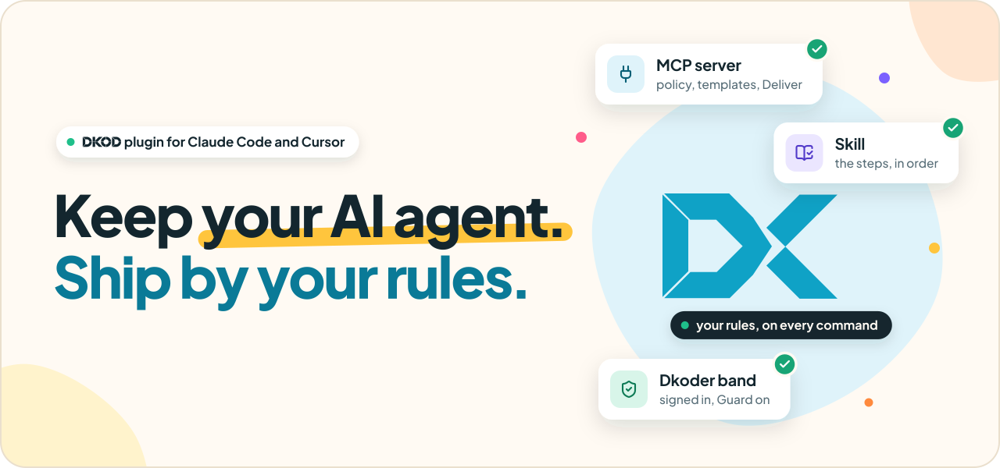
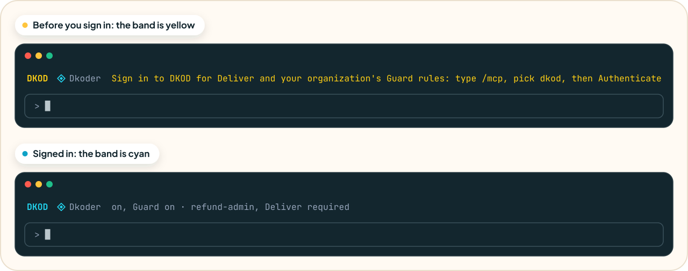

<p align="center">
  <picture>
    <source media="(prefers-color-scheme: dark)" srcset="assets/readme/hero-dark.svg">
    
  </picture>
</p>

<p align="center">Keep using the AI agent you prefer.<br>This plugin brings your company's DKOD into Claude Code and Cursor.</p>

<p align="center">
  <a href="#install"><picture><source media="(prefers-color-scheme: dark)" srcset="assets/readme/install-claude-code-dark.svg"></picture></a>
  <a href="#cursor"><picture><source media="(prefers-color-scheme: dark)" srcset="assets/readme/install-cursor-dark.svg"></picture></a>
  <a href="https://dkod.ai"><picture><source media="(prefers-color-scheme: dark)" srcset="assets/readme/dkod-ai-dark.svg"></picture></a>
</p>

<p align="center">
  <a href="LICENSE"><picture><source media="(prefers-color-scheme: dark)" srcset="assets/readme/badge-license-dark.svg"></picture></a>
  <a href="https://github.com/dkod-ai/dkod-plugin/commits/main"><picture><source media="(prefers-color-scheme: dark)" srcset="assets/readme/badge-version-dark.svg"></picture></a>
  <a href="#install"><picture><source media="(prefers-color-scheme: dark)" srcset="assets/readme/badge-agents-dark.svg"></picture></a>
  <a href="#what-the-rules-check"><picture><source media="(prefers-color-scheme: dark)" srcset="assets/readme/badge-events-dark.svg"></picture></a>
  <a href="https://dashboard.dkod.app/docs"><picture><source media="(prefers-color-scheme: dark)" srcset="assets/readme/badge-docs-dark.svg"></picture></a>
</p>

<p align="center">
  <a href="#what-it-adds"><picture><source media="(prefers-color-scheme: dark)" srcset="assets/readme/nav-adds-dark.svg"></picture></a>
  <a href="#install"><picture><source media="(prefers-color-scheme: dark)" srcset="assets/readme/nav-install-dark.svg"></picture></a>
  <a href="#cursor"><picture><source media="(prefers-color-scheme: dark)" srcset="assets/readme/nav-cursor-dark.svg"></picture></a>
  <a href="#cloud-sessions"><picture><source media="(prefers-color-scheme: dark)" srcset="assets/readme/nav-cloud-dark.svg"></picture></a>
  <a href="#dkoder-and-guard"><picture><source media="(prefers-color-scheme: dark)" srcset="assets/readme/nav-guard-dark.svg"></picture></a>
  <a href="#what-the-rules-check"><picture><source media="(prefers-color-scheme: dark)" srcset="assets/readme/nav-rules-dark.svg"></picture></a>
  <a href="#limits"><picture><source media="(prefers-color-scheme: dark)" srcset="assets/readme/nav-limits-dark.svg"></picture></a>
</p>

<h2 id="what-it-adds"><sub><picture></picture>What it adds</sub><br><picture><source media="(prefers-color-scheme: dark)" srcset="assets/readme/h-adds-dark.svg"></picture></h2>

- **MCP server** `dkod`: your org's policy, templates, Deploy questions, Deploy, build answers, Deliver and Remove.
- **Skill** `dkod`: tells Claude how to use them, in the right order.
- **Dkoder band and rules**: a band above the prompt shows whether you are signed in to DKOD.<br>DKOD's floor checks every command and file write, and once you sign in, so do your organization's Guard&nbsp;rules.

<picture>
  <source media="(prefers-color-scheme: dark)" srcset="assets/readme/band-dark.svg">
  
</picture>

<h2 id="install"><sub><picture></picture>Install</sub><br><picture><source media="(prefers-color-scheme: dark)" srcset="assets/readme/h-install-dark.svg"></picture></h2>

1. Add the marketplace:

   ```
   /plugin marketplace add dkod-ai/dkod-plugin
   ```

2. Install the plugin:

   ```
   /plugin install dkod@dkod-ai
   ```

3. Run `/mcp`, pick `dkod` and choose **Authenticate**. You sign in with your company's own sign-in.<br>DKOD never sees a password.

Until you sign in, the band above the prompt is yellow.

<h2 id="cursor"><sub><picture></picture>Cursor</sub><br><picture><source media="(prefers-color-scheme: dark)" srcset="assets/readme/h-cursor-dark.svg"></picture></h2>

The same repository is a Cursor plugin. In Cursor you get the `dkod` MCP server and the `dkod` skill. You do not get the band or the rules: those run only in Claude Code.

Your team admin can import `dkod-ai/dkod-plugin` as a team marketplace in the Cursor dashboard. To install it for yourself only, on macOS or Linux:

```sh
mkdir -p ~/.cursor/plugins/local/dkod
curl -fsSL https://github.com/dkod-ai/dkod-plugin/archive/refs/heads/main.tar.gz | tar -xz --strip-components 1 -C ~/.cursor/plugins/local/dkod
```

On Windows, in PowerShell:

```powershell
curl.exe -fsSLo "$env:TEMP\dkod-plugin.tar.gz" https://github.com/dkod-ai/dkod-plugin/archive/refs/heads/main.tar.gz
mkdir -Force "$env:USERPROFILE\.cursor\plugins\local\dkod"
tar.exe -xzf "$env:TEMP\dkod-plugin.tar.gz" --strip-components 1 -C "$env:USERPROFILE\.cursor\plugins\local\dkod"
```

It needs no git, so a Mac without Apple's developer tools asks nothing. Do not run it with `sudo`: then root owns the folder, and the update cannot write to it.

Restart Cursor. Then open **Settings → MCP**, find `DKOD` and choose **Connect**. You sign in with your company's own sign-in.

<details>
<summary><b>Update the plugin</b></summary>

Cursor does not update a plugin in `~/.cursor/plugins/local`. The DKOD server tells the agent when your copy is old, and the agent runs the update. It needs no git: your DKOD dashboard serves the plugin, and the update script writes it over the folder. To update by hand:

```sh
node ~/.cursor/plugins/local/dkod/skills/dkod/scripts/dkod-update.mjs ~/.cursor/plugins/local/dkod https://<your DKOD dashboard>/api/v1/dkoder/bundle/cursor.json
```

With Python and no Node, run `dkod-update.py` from the same folder with `python3` and the same two arguments. Cursor loads the new plugin by itself. A team marketplace with **Enable Auto Refresh** on updates by itself.

</details>

<details>
<summary><b>Run the dkod tools without approval</b></summary>

Cursor's Auto-review can stop each dkod tool call for approval. To allow the dkod tools, add them to `mcpAllowlist` in `~/.cursor/permissions.json`:

```json
{
  "mcpAllowlist": ["plugin-dkod-dkod:*", "dkod:*"]
}
```

This list replaces the MCP allowlist in Cursor's settings, so copy those entries into the file too. Run Mode must be Auto-review, Allowlist or Run Everything. See [Cursor permissions](https://cursor.com/docs/reference/permissions).

</details>

<h2 id="cloud-sessions"><sub><picture></picture>Cloud sessions</sub><br><picture><source media="(prefers-color-scheme: dark)" srcset="assets/readme/h-cloud-dark.svg"></picture></h2>

Plugins do not load in a cloud session, so add the DKOD MCP server to the cloud itself. The server gives the agent the dkod skill and its scripts through the `dkoder.guide` tool.

- **Claude Code on the web, or the Desktop app's Cloud:** on claude.ai open **Settings → Connectors**, add a custom connector with this URL and sign in:

  ```
  https://dashboard.dkod.app/api/v1/dkoder/mcp
  ```

  The default **Trusted** network reaches your organization's storage on AWS, Google Cloud and Cloudflare R2.
- **Cursor cloud agents:** add the same URL in the MCP list at [cursor.com/agents](https://cursor.com/agents). A team admin can add it for everyone under **Dashboard → Integrations & MCP**.

<h2 id="dkoder-and-guard"><sub><picture></picture>Dkoder and Guard</sub><br><picture><source media="(prefers-color-scheme: dark)" srcset="assets/readme/h-guard-dark.svg"></picture></h2>

| | Dkoder | Guard |
| -- | -- | -- |
| What | This plugin, in your agent | Your organization's policy, as rules |
| Rules | The floor, the same for every organization | Your organization's own, from its governance repository |
| Needs | Nothing. Works signed out; the band asks you to sign in | Sign-in through `/mcp`, or your company's device install |

<h2 id="what-the-rules-check"><sub><picture></picture>What the rules check</sub><br><picture><source media="(prefers-color-scheme: dark)" srcset="assets/readme/h-rules-dark.svg"></picture></h2>

The rules need to know your org: which GitHub owners are yours, which repository is the governance repository, and the org's own blocked commands. Dkoder gets those facts from DKOD when you sign in through `/mcp`, if your organization turned Guard on. Your company can also install Dkoder on its devices from the DKOD dashboard; that copy cannot be turned off. Then, in the org's repositories, the floor refuses:

- `git push`, `gh pr merge` and GitHub API writes to an app repository. App code ships through Deliver.
- A secret value (private keys, cloud keys, vendor tokens) written into a file.
- Skipped git hooks (`--no-verify`, `core.hooksPath`).

Guard adds your organization's own rules on top, such as blocked commands. A refusal says which one refused: the Dkoder floor, or a Guard rule of your organization.

Before you sign in, nothing names your org, so a repository with a remote is left alone. A folder with no remote still gets the secret check. This plugin sends no events and needs no install file.

<h2 id="limits"><sub><picture></picture>Limits</sub><br><picture><source media="(prefers-color-scheme: dark)" srcset="assets/readme/h-limits-dark.svg"></picture></h2>

> [!IMPORTANT]
> The rules keep Claude on the Deliver path. They are not a security boundary against a person.

To stop direct pushes for real, protect the app repository on GitHub (branch protection or rulesets). DKOD's Deliver does not need a person to push.

<br>

<p align="center">
  <a href="https://dkod.ai"><picture><source media="(prefers-color-scheme: dark)" srcset="assets/readme/dkod-dark.svg"></picture></a>
</p>

<p align="center"><a href="https://dkod.ai">dkod.ai</a> · <a href="https://dashboard.dkod.app/docs">Docs</a>, in the DKOD dashboard for signed-in users · <a href="LICENSE">MIT License</a></p>

<p align="center"><sub>This repository is generated from DKOD's source. Do not edit it here: changes are overwritten by the next release.</sub></p>
